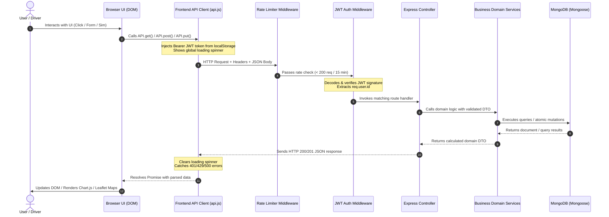
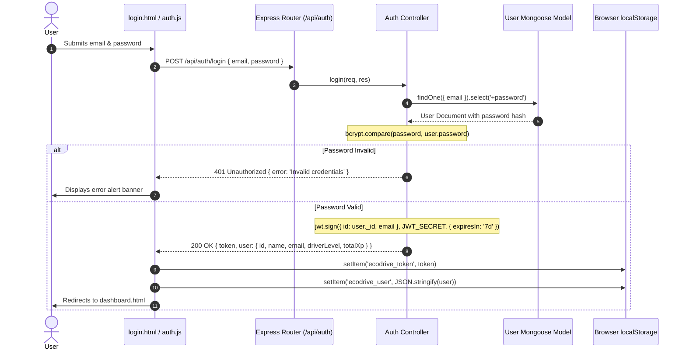
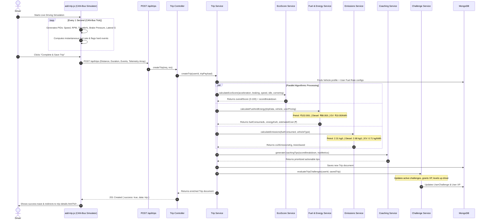
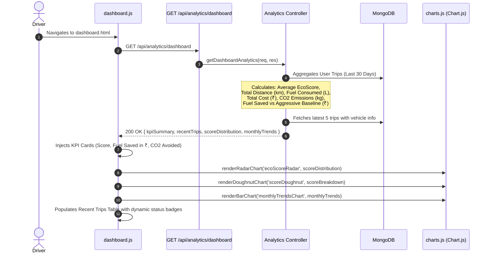
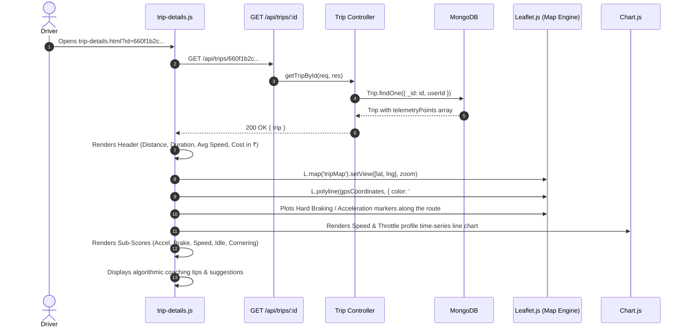
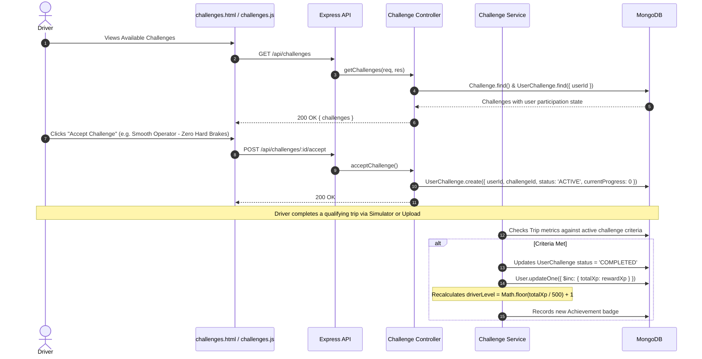

# EcoDrive — Application Flow & Execution Lifecycle

## 1. Overview & Execution Paradigm

The **EcoDrive** platform operates on an asynchronous, decoupled client-server architecture. All user interactions in the frontend initiate structured RESTful HTTP transactions communicating with the Node.js/Express backend, which coordinates specialized domain calculation services and persists state in MongoDB.

This document details the complete end-to-end runtime flows, request/response lifecycles, and data transformations from the browser UI down to the database.

---

## 2. End-to-End Request/Response Lifecycle

Every HTTP request across the platform follows a rigorous, secure path through multiple software layers:



---

## 3. Primary Application Flows

### Flow 1: User Authentication & Session Lifecycle

Authentication in EcoDrive is stateless and token-based using cryptographic JSON Web Tokens (JWT).



#### Route Protection Mechanism (`guards.js`):
1. When any protected page loads (`dashboard.html`, `trips.html`, `vehicles.html`, etc.), `guards.js` executes immediately in the `<head>` or initial script block.
2. If `localStorage.getItem('ecodrive_token')` is null or empty, the browser immediately redirects to `login.html`.
3. If an API request returns an HTTP `401 Unauthorized` (e.g., token expired), `api.js` automatically clears the stale token and redirects the driver to the login screen.

---

### Flow 2: Trip Ingestion & Telemetry Processing Pipeline

This is the central computational pipeline of EcoDrive. It supports both manual trip entry and real-time synthetic CAN-bus / OBD-II driving simulation.



---

### Flow 3: Dashboard Analytics & Aggregation Flow

When a driver opens `dashboard.html`, the application performs parallel queries to build a comprehensive real-time telematics overview.



---

### Flow 4: Trip Deep-Dive & Forensic Inspection Flow

When viewing a specific trip (`trip-details.html?id=...`), the user examines granular GPS breadcrumbs, second-by-second telematics, and personalized coaching feedback.



---

### Flow 5: Garage Management & Custom Fuel Pricing Flow

Vehicles and custom market rates can be configured to match real-world regional pricing.

```mermaid
sequenceDiagram
    autonumber
    actor Driver as Driver
    participant VehiclesUI as vehicles.html / vehicles.js
    participant SettingsUI as settings.html / settings.js
    participant API as Express Router
    participant UserCtrl as User Controller / Vehicle Controller
    participant DB as MongoDB

    rect rgb(20, 30, 45)
    Note over Driver,DB: 5A. Adding a New Vehicle to Garage
    Driver->>VehiclesUI: Selects Fuel Type: PETROL | DIESEL | ELECTRIC | HYBRID
    Driver->>VehiclesUI: Enters Make, Model, Year, Engine Size (L)
    VehiclesUI->>API: POST /api/vehicles { make, model, fuelType, engineSizeL, ... }
    API->>UserCtrl: createVehicle()
    UserCtrl->>DB: Vehicle.create()
    DB-->>UserCtrl: Vehicle saved
    UserCtrl-->>VehiclesUI: 201 Created
    VehiclesUI->>Driver: Renders new vehicle card in garage
    end

    rect rgb(25, 40, 35)
    Note over Driver,DB: 5B. Updating Regional Fuel & Energy Prices
    Driver->>SettingsUI: Updates Petrol (₹102), Diesel (₹88), Electricity (₹10)
    SettingsUI->>API: PUT /api/user/settings { petrolPriceConfig, dieselPriceConfig, electricityPriceConfig }
    API->>UserCtrl: updateSettings()
    UserCtrl->>DB: User.findByIdAndUpdate(userId, { ...pricingConfigs })
    DB-->>UserCtrl: Updated User Document
    UserCtrl-->>SettingsUI: 200 OK
    SettingsUI->>Driver: Displays "Fuel rate preferences updated successfully"
    end
```



---

### Flow 6: Gamification, Challenges & Leaderboard Progression

EcoDrive motivates drivers to adopt fuel-efficient habits through an integrated reward loop.



---

### Flow 7: Error Handling, Resilience & Edge Cases

The platform guarantees graceful degradation and clear error reporting across all layers:

| Error Condition | Trigger Point | HTTP Status | System Response & User Experience |
| :--- | :--- | :--- | :--- |
| **Expired / Invalid JWT** | Client request with stale token | `401 Unauthorized` | Intercepted by `api.js`. `localStorage` cleared, user redirected to `login.html` with an explanatory toast. |
| **Rate Limit Breached** | > 200 requests in 15 minutes | `429 Too Many Requests` | Handled by `apiRateLimiter`. Client receives `{ error: { code: 'RATE_LIMIT_EXCEEDED' } }` and displays cooldown alert. |
| **Schema Validation Error** | Invalid input fields (e.g. negative distance) | `400 Bad Request` | Handled by `express-validator`. Returns exact field-level validation errors to display beneath form inputs. |
| **Database Disconnection** | MongoDB temporary drop | `503 Service Unavailable` | Backend logs error via `error.middleware.js`, returns standardized error envelope without exposing internal stack traces. |
| **Backend Server Cold Start** | Initial fetch on Render free tier | `Fetch Timeout / 502` | `api.js` catches connection timeout, shows an informative notification explaining server wake-up, and offers a retry button. |
| **Legacy Currency Fallback** | Historical trips stored in USD ($1.50) | Handled in runtime | Backend analytics controller and frontend `utils.formatCurrency` auto-convert legacy values $< ₹25$ into Indian Rupees (₹) to prevent visual artifacts. |

---

## 8. Summary of Data Transformations Across the Stack

```
[Driver Action / Sensor Input]
       ↓  (Browser Event: Click / Range Slider / Form Submit)
[Synthetic CAN-bus State]
       ↓  (PID Telemetry: Speed km/h, RPM, Throttle %, Brake Bar, Lateral G)
[Client JSON Payload]
       ↓  (POST /api/trips with JWT Bearer Token)
[Express Security & Auth Middleware]
       ↓  (Decoded req.user.id, sanitized req.body)
[Trip Service Orchestration]
       ├──> EcoScore Engine (Acceleration, Braking, Speed, Idle, Cornering → 0-100)
       ├──> Fuel & Energy Engine (Liters / kWh × ₹102 Petrol / ₹88 Diesel / ₹10 EV)
       ├──> Emissions Engine (Liters × 2.31/2.68 kg CO2 → Trees Equivalent)
       └──> Dynamic Coaching Engine (Diagnostic Rule Trees → Actionable Advice)
       ↓
[Mongoose ODM Persistence]
       ├──> Write to `trips` collection
       ├──> Update `users` collection (XP & Driver Level increment)
       └──> Update `userchallenges` collection (Progress update / Unlock)
       ↓
[Normalized REST API Response]
       ↓  ({ success: true, data: { ...trip, scoreBreakdown, costInRupees } })
[Frontend Visualization & DOM Hydration]
       ├──> Chart.js Canvas Render (Radar / Line / Doughnut / Bar)
       ├──> Leaflet.js GeoJSON Polyline & Markers
       └──> Responsive KPI Card Hydration with Indian Rupee (₹) formatting
```
