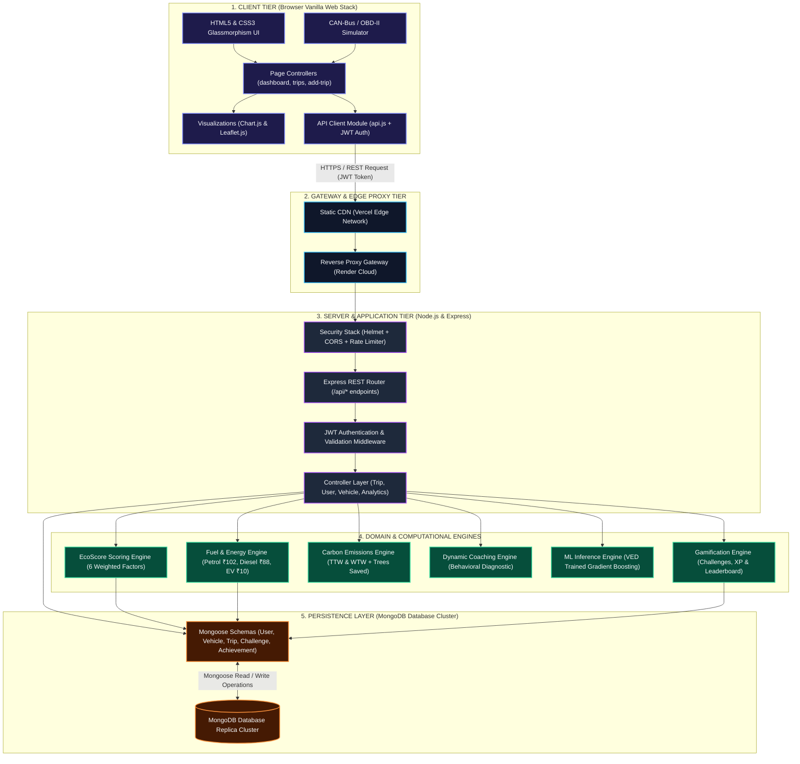
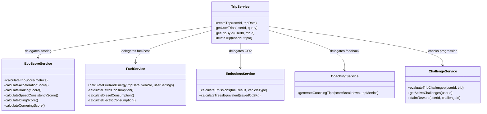
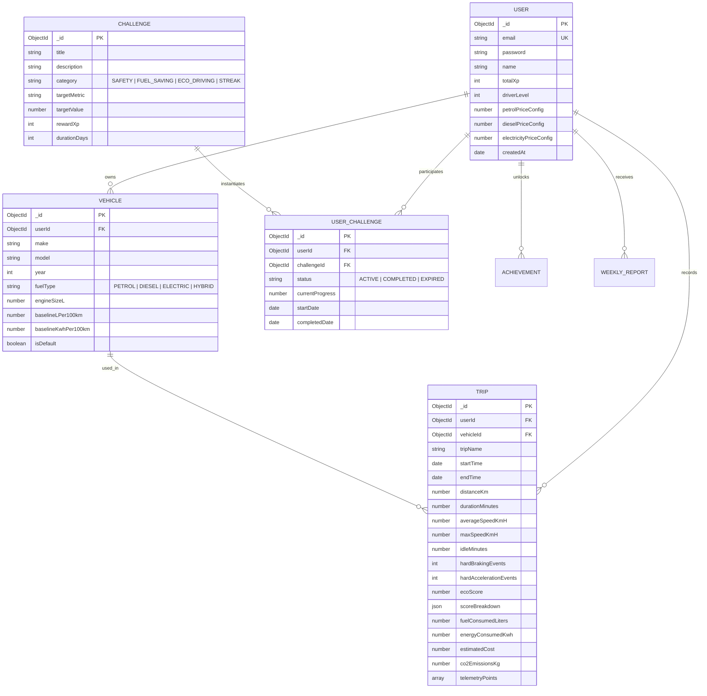

# EcoDrive — System Architecture Specification

## 1. Executive Summary & Purpose

**EcoDrive** is an intelligent, fullstack connected-vehicle analytics, eco-driving scoring, and carbon reduction platform. It ingests high-frequency vehicular telemetry (CAN-bus / OBD-II data), processes multi-dimensional driving behavior, computes physics-based fuel and electrical energy consumption, quantifies carbon emissions, and provides algorithmic driver coaching with gamified incentives.

This document details the architectural topology, design patterns, technology choices, data pipelines, and computational engines that govern the EcoDrive platform.

---

## 2. High-Level System Architecture

EcoDrive utilizes a **Layered Modular N-Tier Architecture** emphasizing separation of concerns, high throughput telemetry processing, and decoupled algorithmic domain engines.

---

## 3. Technology Stack & Decision Rationale

| Layer | Technologies Selected | Architectural Justification |
| :--- | :--- | :--- |
| **Frontend UI** | HTML5 Semantic Elements, Custom CSS3 Design System | Eliminates heavy framework overhead (React/Angular), guarantees sub-100ms first contentful paint (FCP), supports native browser performance. |
| **Frontend Styling** | Vanilla CSS3, Glassmorphism, CSS Custom Properties | Pure tokenized design system (`--bg-primary`, `--accent-teal`, `--glass-bg`). Eliminates build-step dependencies while offering modern aesthetics. |
| **Client Scripting** | Vanilla JavaScript (ES6+ Modules) | Native DOM manipulation, async/await pipelines, and modular separation (`api.js`, `charts.js`, `utils.js`). |
| **Data Visualization** | Chart.js v4.4.1 | Hardware-accelerated Canvas 2D charts (Radar, Doughnut, Multi-Axis Line, and Bar charts) for telemetry and driving behavior metrics. |
| **Geospatial Mapping** | Leaflet.js v1.9.4 & OpenStreetMap | Lightweight, open-source GPS route mapping, polyline rendering, and speed/braking heatmap overlays without proprietary map API keys. |
| **Backend Runtime** | Node.js (v18+ LTS) | Non-blocking, event-driven I/O model ideally suited for telemetry ingestion and high-concurrency API requests. |
| **Web Framework** | Express.js (v4.18.2) | Battle-tested, lightweight HTTP server framework featuring clean middleware composability. |
| **Database** | MongoDB with Mongoose ODM (v8.2.1) | Flexible JSON document model natively matching variable-length OBD-II telemetry time-series and nested driving metric structures. |
| **Authentication** | JSON Web Tokens (`jsonwebtoken`) & `bcryptjs` | Stateless, cryptographically signed Bearer authentication paired with salted key-derivation for credential storage. |
| **Security & Hardening** | `helmet`, `cors`, `express-rate-limit` | Automated HTTP response header hardening, granular origin whitelisting, and IP-level DDoS/brute-force rate limiting. |
| **Testing Suite** | Jest (v29.7.0) & Supertest (v6.3.4) | Unit testing for math/scoring engines and integration testing for all RESTful API endpoints. |

---

## 4. Architectural Layers & Separation of Concerns

### 4.1. Presentation Layer (Frontend)
- **Directory**: `/frontend`
- **Pages**:
  - `index.html`: Public product showcase, feature highlights, and telemetry demo.
  - `dashboard.html`: Command center displaying overall EcoScore, fuel saved (₹), carbon avoided, telemetry radar charts, and recent trip history.
  - `trips.html`: Paginated historical trip feed with search, filtering, and sorting.
  - `trip-details.html`: Deep-dive forensic analysis of a single trip featuring GPS route map, telemetry time-series, score breakdown, and coaching advice.
  - `add-trip.html`: Dual-mode ingestion interface offering manual form entry or a real-time CAN-bus / OBD-II synthetic driving simulator.
  - `vehicles.html`: Fleet and garage management (Petrol, Diesel, Hybrid, and EV profiles).
  - `challenges.html`: Gamification hub displaying active driver challenges, XP progress, and badges.
  - `leaderboard.html`: Global and vehicle-class eco-driver rankings.
  - `reports.html`: Weekly driving performance audits with exportable summaries.
  - `settings.html`: User preferences and fuel rate configurations (Petrol ₹/L, Diesel ₹/L, Electricity ₹/kWh).
- **Core Scripts**:
  - `api.js`: Unified HTTP abstraction with automatic authorization headers, global request counter, loading spinner, and 401 interceptors.
  - `components.js`: Dynamic injection of standardized navigation headers, footers, and active session indicators across all pages.
  - `guards.js`: Client-side route protection redirecting unauthenticated users to `login.html`.
  - `charts.js`: Chart.js factory generating radar behavior graphs, efficiency doughnuts, and speed profiles.

### 4.2. API & Controller Layer (Backend)
- **Directory**: `/backend/controllers` & `/backend/routes`
- **Responsibilities**:
  - Translates incoming HTTP requests into service-layer domain calls.
  - Enforces schema validation using `express-validator` and custom validation rules.
  - Extracts authenticated user context (`req.user.id`) from verified JWT tokens.
  - Formats uniform JSON API responses (`{ success: true, data: ... }` or `{ success: false, error: ... }`).
  - Shields business logic from HTTP transport specifics.

### 4.3. Business & Algorithmic Domain Services Layer
- **Directory**: `/backend/services`
- **Design Pattern**: Service Layer Pattern isolating pure calculation logic from database models.

### 4.4. Persistence & Data Access Layer
- **Directory**: `/backend/models`
- **Engine**: Mongoose ODM with MongoDB.
- Employs strict schema definitions, compound indexes for rapid query execution, pre-save hooks (e.g., password hashing), and virtual properties.

---

## 5. Algorithmic Domain Engines

### 5.1. EcoScore Engine (`ecoScore.service.js`)
The EcoScore is a normalized index ($0 - 100$) derived from five weighted telemetry factors:

$$\text{EcoScore} = 0.25 S_{\text{accel}} + 0.25 S_{\text{brake}} + 0.20 S_{\text{speed}} + 0.15 S_{\text{idle}} + 0.15 S_{\text{corner}}$$

1. **Acceleration Score ($S_{\text{accel}}$, 25% weight)**:
   - Evaluates rapid throttle applications and acceleration spikes ($> 0.3g$ / $> 3.0\text{ m/s}^2$).
   - Penalty: $5 \times \text{hardAccelerationEvents}$.
2. **Braking Score ($S_{\text{brake}}$, 25% weight)**:
   - Measures kinetic energy loss from severe deceleration ($< -0.3g$ / $< -3.0\text{ m/s}^2$).
   - Penalty: $6 \times \text{hardBrakingEvents}$.
3. **Speed Consistency ($S_{\text{speed}}$, 20% weight)**:
   - Evaluates cruising efficiency. Penalties applied for sustained speeding over $100\text{ km/h}$ or erratic velocity fluctuation.
4. **Idling Efficiency ($S_{\text{idle}}$, 15% weight)**:
   - Quantifies fuel wasted while stationary with engine running. Penalizes idle duration exceeding 5% of total trip time.
5. **Cornering / Lateral G-Force ($S_{\text{corner}}$, 15% weight)**:
   - Evaluates lateral stability and tire scrub during turns ($> 0.35g$ lateral acceleration).

### 5.2. Fuel & Energy Calculation Engine (`fuel.service.js`)
Computes precise fuel consumption and financial cost based on vehicle powertrain and latest localized market rates:

- **Configured Market Baseline Rates**:
  - **Petrol**: ₹102.00 / Liter
  - **Diesel**: ₹88.00 / Liter
  - **Electricity (EV)**: ₹10.00 / kWh
- **Internal Combustion (ICE) Formula**:
  $$\text{Fuel Consumed (L)} = \frac{\text{Distance (km)} \times \text{Baseline L/100km}}{100} \times \left(1 + \frac{100 - \text{EcoScore}}{200}\right)$$
  $$\text{Trip Cost (₹)} = \text{Fuel Consumed (L)} \times \text{Fuel Rate (₹/L)}$$
- **Electric Vehicle (EV) Formula**:
  $$\text{Energy Consumed (kWh)} = \frac{\text{Distance (km)} \times \text{Rated kWh/100km}}{100} \times \left(1 + \frac{100 - \text{EcoScore}}{250}\right) - \text{Regenerative Energy}$$
  $$\text{Trip Cost (₹)} = \text{Energy Consumed (kWh)} \times \text{Electricity Rate (₹/kWh)}$$

### 5.3. Carbon Emissions Engine (`emissions.service.js`)
Quantifies Tank-to-Wheel (TTW) direct emissions and Well-to-Wheel (WTW) lifecycle impact:
- **Emission Factors**:
  - Petrol: $2.31\text{ kg CO}_2 / \text{Liter}$
  - Diesel: $2.68\text{ kg CO}_2 / \text{Liter}$
  - Electric Grid Average: $0.71\text{ kg CO}_2 / \text{kWh}$ (National Grid Carbon Intensity)
- **Carbon Offset Equivalencies**:
  - 1 Mature Urban Tree absorbs approximately $21.77\text{ kg CO}_2$ per year ($0.0596\text{ kg CO}_2 / \text{day}$).
  $$\text{Trees Equivalent} = \frac{\text{CO}_2 \text{ Saved (kg)}}{21.77}$$

### 5.4. Dynamic Coaching Engine (`coaching.service.js`)
Performs algorithmic diagnosis of driver telematics:
- Identifies the lowest sub-score factor.
- Evaluates specific event density (e.g., hard stops per 10 km).
- Synthesizes contextual, prioritized recommendations (e.g., *"Anticipate traffic lights 100m earlier to reduce hard braking and capture regenerative energy"*).

---

## 6. Database Architecture & Schema Design

### Critical Database Indexing Strategy
To maintain sub-15ms response times across analytics and dashboard queries:
- `Trip`: `{ userId: 1, startTime: -1 }` (Compound index powering dashboard metrics and trip history pagination).
- `Trip`: `{ vehicleId: 1 }` (Vehicle efficiency benchmarking).
- `User`: `{ email: 1 }` (Unique index for high-speed authentication).
- `UserChallenge`: `{ userId: 1, status: 1 }` (Active challenge lookup).
- `Vehicle`: `{ userId: 1, isDefault: 1 }` (Quick retrieval of primary active vehicle).

---

## 7. Security Architecture & Threat Mitigation

1. **Authentication & Session Lifecycle**:
   - Stateless JSON Web Tokens (JWT) signed using HMAC-SHA256 (`JWT_SECRET`).
   - Tokens contain non-sensitive payload claims (`id`, `email`) with configurable expiry (`7d`).
   - Passwords hashed using `bcryptjs` with salt round cost factor 10.
2. **HTTP Hardening & Network Defense**:
   - **Helmet**: Enforces Strict-Transport-Security (HSTS), X-Content-Type-Options (`nosniff`), X-Frame-Options (`SAMEORIGIN`), and Content Security Policy basics.
   - **CORS Policy**: Dynamic origin validation whitelist allowing local development servers (`localhost:3000`, `localhost:5000`) and production deployment domains (`*.vercel.app`).
   - **Rate Limiting**: Sliding-window rate limiter restricting IP addresses to a max of 200 API requests per 15 minutes, neutralizing brute-force and credential-stuffing attacks.
3. **Data Validation & Sanitization**:
   - Strict payload parsing rejecting non-numeric values for physical quantities (speed, distance, engine displacement).
   - Strict enumeration guards for fuel types (`PETROL`, `DIESEL`, `ELECTRIC`, `HYBRID`) and challenge categories (`SAFETY`, `FUEL_SAVING`, `ECO_DRIVING`, `STREAK`).

---

## 8. Deployment Topology

- **Frontend**: Static Web Assets hosted via Vercel Edge / Static CDN.
- **Backend**: Containerized Node.js runtime hosted on Render / Linux VPS with Node process monitoring.
- **Database**: MongoDB Atlas Managed Cluster with replica sets, automated daily snapshots, and TLS/SSL in-transit encryption.
- **Continuous Integration**: Local automated regression testing pipeline (`npm test`) executing Jest suites prior to every Git push.
