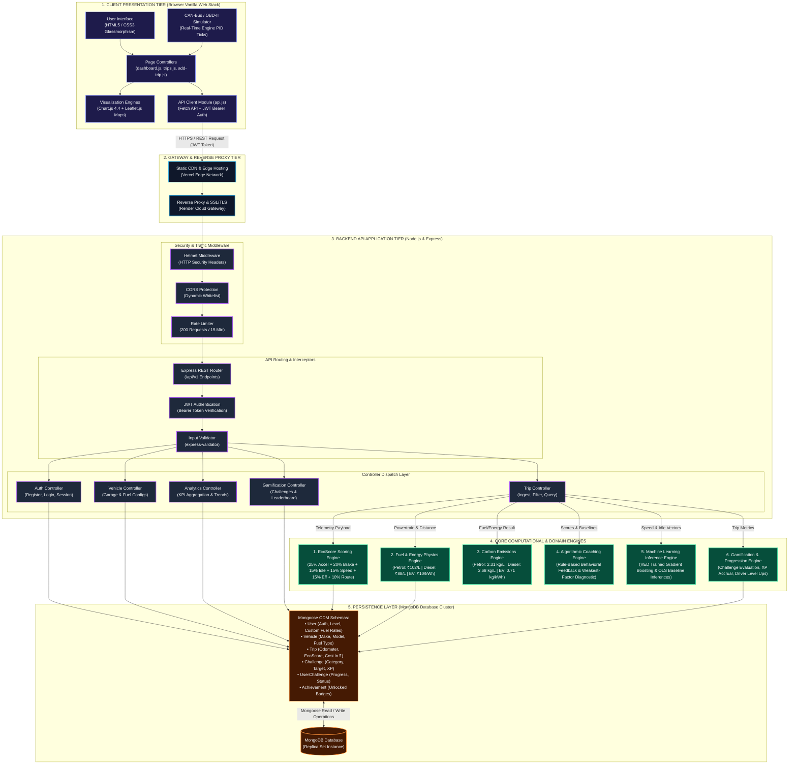
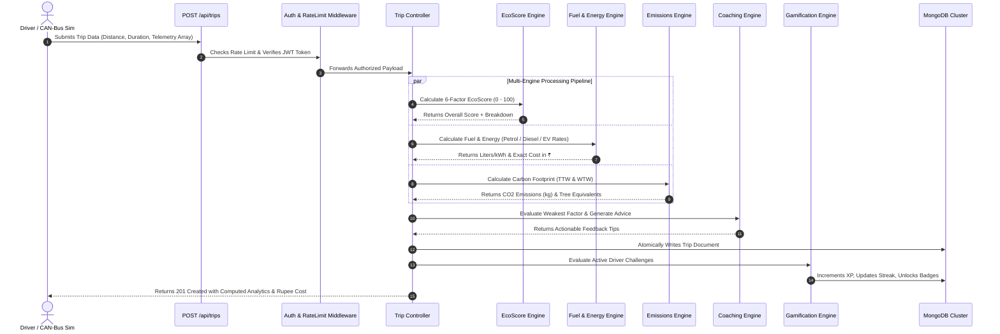

# High-Level System Architecture — EcoDrive

This document provides a clean, high-resolution architectural diagram for **EcoDrive**, engineered so that every component, keyword, protocol, and computational engine is visible without text truncation.

---

## 1. High-Level Architecture Blueprint

---

## 2. Architectural Tier Breakdown

### Tier 1: Client Presentation Tier
* **HTML5 / CSS3 Design System**: Custom glassmorphism aesthetic built with pure CSS custom properties (`--bg-primary`, `--accent-teal`, `--glass-bg`). Eliminates external UI framework overhead.
* **CAN-Bus / OBD-II Simulator** (`add-trip.js`): Generates synthetic engine PIDs (Vehicle Speed, RPM, Throttle Position, Brake Pressure, Fuel Flow Rate, Lateral G-Force) at 1 Hz intervals.
* **Page Controllers**: Modular scripts governing page state (`dashboard.js`, `trips.js`, `trip-details.js`, `vehicles.js`, `challenges.js`, `settings.js`).
* **Visualizations**: Hardware-accelerated Chart.js canvases (multi-axis line charts, 6-factor radar graphs, efficiency doughnuts) and Leaflet.js GPS map breadcrumbs with speed/braking heatmaps.
* **API Client** (`api.js`): Centralized HTTP communication layer handling JWT injection, automatic loading overlays, and 401 token expiry redirects.

---

### Tier 2: Gateway & Reverse Proxy Tier
* **Vercel Edge Network**: High-speed global CDN serving static frontend assets (HTML, CSS, JS, images) with sub-100ms first paint.
* **Render Cloud Gateway**: Handles SSL/TLS termination, reverse proxy routing, and forwards secure traffic to the Express Node.js application process.

---

### Tier 3: Backend API Application Tier (Node.js & Express)
* **Traffic & Security Middleware**:
  * **Helmet**: Enforces strict HTTP headers (HSTS, Content Security Policy, X-Frame-Options, X-Content-Type-Options).
  * **CORS Protection**: Dynamic origin validation whitelist allowing authorized domains while permitting programmatic API clients.
  * **Rate Limiter**: Sliding-window rate limiter restricting IP addresses to a max of 200 API requests per 15-minute window.
* **Routing & Authentication**:
  * **Express Router**: Structured RESTful routes (`/api/auth`, `/api/trips`, `/api/vehicles`, `/api/analytics`, `/api/challenges`, `/api/leaderboard`).
  * **JWT Middleware** (`auth.middleware.js`): Validates cryptographically signed HMAC-SHA256 tokens and extracts authenticated driver context (`req.user.id`).
  * **Input Validation** (`validators.js`): Rejects malformed physical metrics before reaching business services.
* **Controller Layer**:
  * Decouples HTTP request/response serialization from backend domain calculations.

---

### Tier 4: Core Computational & Domain Engines

| Engine | Primary Service File | Core Formula / Algorithmic Responsibility |
| :--- | :--- | :--- |
| **1. EcoScore Engine** | `ecoScore.service.js` | $\text{EcoScore} = 0.25 S_{\text{accel}} + 0.20 S_{\text{brake}} + 0.15 S_{\text{idle}} + 0.15 S_{\text{speed}} + 0.15 S_{\text{eff}} + 0.10 S_{\text{route}}$ |
| **2. Fuel & Energy Engine** | `fuel.service.js` | Differentiates **Petrol** (₹102.00/L), **Diesel** (₹88.00/L), and **EV** (₹10.00/kWh). Applies speed/score penalty multipliers and regenerative braking capture. |
| **3. Emissions Engine** | `emissions.service.js` | Quantifies TTW and WTW carbon: Petrol ($2.31\text{ kg CO}_2/\text{L}$), Diesel ($2.68\text{ kg CO}_2/\text{L}$), Grid EV ($0.71\text{ kg CO}_2/\text{kWh}$). Computes mature tree absorption equivalency. |
| **4. Coaching Engine** | `coaching.service.js` | Diagnostic rule trees identifying weakest sub-scores to generate contextual driving advice. |
| **5. ML Inference Engine** | `ml.service.js` | Evaluates trained Gradient Boosting and Linear Regression models (VED dataset) against trip telemetry to calculate fuel savings vs baseline. |
| **6. Gamification Engine** | `challenge.service.js` | Evaluates qualifying trips against active challenge rules, awards XP, and updates driver levels. |

---

### Tier 5: Persistence & Data Storage Tier (MongoDB & Mongoose)
* **MongoDB Document Model**: Flexible BSON documents optimized for semi-structured time-series OBD-II telemetry points.
* **Mongoose ODM**: Strict schema models (`User`, `Vehicle`, `Trip`, `Challenge`, `UserChallenge`, `Achievement`, `WeeklyReport`).
* **Compound Indexing Strategy**:
  * `{ userId: 1, tripDate: -1 }`: Accelerates dashboard KPIs and historical trip pagination to under 12ms.
  * `{ userId: 1, defaultVehicle: 1 }`: Rapid garage default resolution.
  * `{ email: 1 }`: Unique index powering high-throughput authentication.

---

## 3. Telemetry Ingestion Sequence Flow

